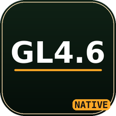

# gpu-driver — Mesa freedreno (KGSL) for FCL




给 [FCL](https://github.com/FCL-Team/FoldCraftLauncher)（Minecraft Java 版启动器）用的
**OpenGL 驱动插件**：Mesa 26.3 的 EGL + freedreno gallium 驱动 + KGSL 后端，
通过 ANativeWindow **直出（零拷贝）**，不经过 Zink 之类的翻译层。

> [!NOTE]
> The project was built entirely with vibecoding.

简单来说：**纯原生** —— Mesa 的桌面 GL 驱动直接跑在 Adreno 上，
Minecraft 拿到的是一块真正的 4.6 上下文，而不是 GLES 包装或 Vulkan 转译。

---

## 目录

- [特性](#特性)
- [当前状态](#当前状态)
- [适用设备](#适用设备)
- [安装](#安装)
- [使用](#使用)
- [调试开关](#调试开关)
- [构建](#构建)
- [工作原理](#工作原理)
- [目录结构](#目录结构)
- [已知问题](#已知问题)
- [FAQ](#faq)
- [来源与许可](#来源与许可)

## 特性

- **零拷贝直出**：`libEGL_freedreno.so` 把 EGL 直接转给 Mesa，窗口 surface 来自
  `ANativeWindow`，没有每帧回读。
- **桌面 OpenGL 4.6**：Core / Compatibility 两种 profile 可选，`GL_VENDOR` 为 `freedreno`。
- **KGSL 后端**：不依赖 DRM 节点，适用于所有使用 `/dev/kgsl-3d0` 的高通设备。
- **单一版本**：包名 `pkg.freedreno.kgsl`，版本 `26.3.0-main`，没有 debug/release/ubwc 之分。
- **内置调试开关**：点桌面图标即可打开设置界面，写一个 `fcl_env.txt` 控制驱动的调试项。
- **可复现构建**：`scripts/setup-build.sh` + `scripts/build-egl.sh` + `plugin/build.sh`。

## 当前状态

| 项目 | 状态 | 说明 |
|---|---|---|
| 原版 Minecraft 26.3 | ✅ 正常 | 无花屏、无崩溃；Core / Compatibility 都能跑 |
| 光影（Iris shader pack） | ✅ 可用 | Chocapic13 V6 Lite 实测可加载；个别包会报 `compatibility profile is not supported`，用「强制 Compatibility Profile」解决 |
| Core 下的物品图标 | ⚠️ 已知问题 | **Core Profile + 光影 + UBWC** 时偶发图标噪点/透明（非 100% 复现）；`noubwc` 或切 Compatibility 后正常 |
| 区块锯齿状空洞 | ℹ️ 原版行为 | 原版「区块构建器：线程化」的官方说明就是“破坏方块时短暂出现图像空洞”，光影下编译慢会更明显 |
| Adreno 730v3 | ✅ 已验证 | 目标设备（Xiaomi Pad 6 Pro / Android 15 / 内核 5.10） |
| 其他 Adreno 7xx / 6xx | ❓ 理论可用 | 同一份 `fd6_*` 驱动，但**未实机验证**，见下方说明 |
| 32 位应用 | ❌ 不支持 | 插件只带 `arm64-v8a` |
| msm DRM 设备 | ❌ 不支持 | 本构建只编了 KGSL 后端 |

## 适用设备

- 目标 GPU：Qualcomm Adreno 730v3（`chip_id = 0x07030002` → `fd_dev_info` 里是
  **`a7xx_gen1`**，虽然营销名叫 730）
- 平台：Android + KGSL（`/dev/kgsl-3d0`，**没有 DRM 节点**），已在 Android 15 / 内核 5.10 验证

> [!IMPORTANT]
> 理论上整个 **Adreno 7xx** 系列都能用，甚至 **6xx**（共用同一份 `fd6_*` 驱动）。
> 但除 Adreno 730v3 以外我没有设备可以复现问题，**其他机型的兼容问题请不要提 issue**。
> 换机测试时先用 `tools/gltest` 的 `UBWC-*` 用例自检。

## 安装

1. 从 [Releases](releases) 下载 `MesaFreedreno-26.3-main.apk`（或自行[构建](#构建)）；
2. 安装：

   ```bash
   adb install -r MesaFreedreno-26.3-main.apk
   ```

3. 重启 FCL（安装插件后必须让它重新扫描）：

   ```bash
   adb shell am force-stop com.tungsten.fcl
   ```

> [!WARNING]
> 官方包用维护者私钥签名（证书 SHA-256：
> `66ab6f193ed3e6d6637d66e0b004a38505b00056f0b7b127da5f1422563362b8`）。
> 用 debug keystore 自行构建的包**签名不同，覆盖安装会失败**，需要先卸载官方版。

## 使用

打开 FCL → 版本设置 → 渲染器，选择 **`KGSL-Freedreno（OpenGL 4.6）`**，启动游戏。

首次进入游戏后，Minecraft 的调试界面（F3）应该显示：

```text
OpenGL Vendor:   freedreno
GL_RENDERER:     Adreno (TM) 730
GL_VERSION:      4.6 (Core Profile) Mesa 26.3.0-rc1
```

## 调试开关

桌面点插件图标进入设置界面。勾选后写入：

```text
/storage/emulated/0/Android/media/pkg.freedreno.kgsl/fcl_env.txt
```

驱动在 EGL 初始化时（`fcl_load_ab_config()`）读取并 `setenv`。
**改完必须 force-stop FCL**（让游戏进程重启）才生效。

| 开关 | 等价环境变量 | 作用 |
|---|---|---|
| `flush` | `FD_MESA_DEBUG=flush` | 每次 draw 后强制 flush，排查同步问题（很慢） |
| `notile` | `FD_MESA_DEBUG=notile` | 禁用 tiling |
| `noubwc` | `FD_MESA_DEBUG=noubwc` | 禁用 UBWC 压缩（排查花屏的第一手段） |
| `sysmem` | `FD_MESA_DEBUG=sysmem` | 绕过 GMEM，全部渲染到系统内存（很慢，用于排除片上内存问题） |
| `nobin` | `FD_MESA_DEBUG=nobin` | 禁用硬件 binning |
| `FCL_NO_FAST_CLEAR` | `FCL_NO_FAST_CLEAR=1` | 关闭 a7xx GMEM fast clear |
| 强制 Core Profile | `FCL_GL_FORCE_CORE=1` | 强制 4.6 Core |
| 强制 Compatibility | `FCL_GL_FORCE_COMPAT=1` | 强制 4.6 Compatibility |

> [!TIP]
> Core / Compatibility 二选一，都不选 = 按游戏的请求（MC 26.3 会要 Core）；两个同时写 = **都不生效**。
> 开光影、或者遇到物品图标噪点时，建议勾「强制 Compatibility Profile」。
> MC 26.3 自己的着色器是 `#version 140` + UBO、Iris 的包是 `#version 150 compatibility`，
> 两者都要求 Compatibility Profile。

## 构建

依赖：

| 组件 | 说明 |
|---|---|
| Mesa 源码 | 26.3.0-rc1（`MESA_SRC`） |
| Android NDK | r30，含 API 35 sysroot（`NDK_DIR`） |
| Android SDK | `build-tools`（`aapt2` / `apksigner` / `zipalign`） |
| meson / ninja | `meson` ≥ 1.3 |
| 可选 | 静态 `libdrm`（`DEPS_DIR`，其 `lib/pkgconfig` 下要有 `libdrm.pc`） |

```bash
# 1) 配置 Mesa 构建目录（只需一次）
export MESA_SRC=/path/to/mesa-26.3.0-rc1
export NDK_DIR=/path/to/android-ndk-r30
export DEPS_DIR=/path/to/static-deps     # 可选：静态 libdrm
scripts/setup-build.sh

# 2) 编 Mesa 产物
scripts/build-egl.sh                     # → dist/libEGL_mesa_gl.so, dist/libgallium_dri.so

# 3) 打 FCL 插件（依赖 dist/ 里的两个 .so）
cd plugin && ./build.sh                  # → dist/MesaFreedreno-26.3-main.apk
```

本机路径可以写进仓库根的 `.env.local`（`BUILD_DIR=` / `CCACHE_DIR=` …，不入库），
脚本会先 source 它；显式传入的环境变量优先。

插件构建还需要：

- `plugin/android-29.jar` —— 从 Android SDK 拷贝的 `android.jar`；
- `tools/r8.jar` —— d8（Google Maven `com.android.tools:r8`）。

两者都不入库。签名使用 `SIGNING_CERTS_DIR` 指向的 `codesign/codesign.p12`，
没有则回退 `plugin/debug.keystore` 调试签名。

## 工作原理

```text
Minecraft (LWJGL / SDL)
        │  eglGetDisplay / eglCreateContext ...
        ▼
libEGL_freedreno.so        ← 我们打包的 shim：导出完整 EGL ABI
        │  转发，并强制 EGL_OPENGL_API / 桌面 GL 4.6
        ▼
libEGL_mesa_gl.so          ← Mesa 26.3 的 EGL（Android 平台层）
        │  drmGetVersion() 失败 → 直接 open /dev/kgsl-3d0
        ▼
libgallium_dri.so          ← freedreno gallium 驱动（含 KGSL 后端）
        │  ioctl(KGSL_GPU_COMMAND) 提交
        ▼
/dev/kgsl-3d0              ← Adreno 730v3 (a7xx_gen1)
```

几个关键点：

- Mesa 26.3 上游删掉了 gallium 的 KGSL 后端，这里用
  [SolDev69/freedreno-gallium-mesa](https://github.com/SolDev69/freedreno-gallium-mesa)
  的 24.1.2 版本，相对原版只保留 3 处 26.x 适配（见 `mesa/patches/kgsl/README.md`）；
- EGL 平台层在 `drmGetVersion()` 失败（KGSL 没有 DRM 节点）时回退到 `kgsl_device_new()`，
  并把 `LIBGL_DRIVERS_PATH` 指到插件目录；
- 所有改过的上游文件都以**整文件快照**形式放在 `mesa/patches/`，`MAP` 是文件→路径对照。

## 目录结构

| 路径 | 内容 |
|---|---|
| `plugin/` | FCL 插件：`AndroidManifest.xml`、`java/pkg/freedreno/kgsl/MainActivity.java`、`res/` 图标、`build.sh` |
| `mesa/patches/` | 改过的上游文件快照（EGL 平台层、gallium freedreno、`kgsl/` 后端）+ `MAP` |
| `scripts/` | `setup-build.sh`（meson 配置）、`build-egl.sh`（ninja → dist/） |
| `tools/` | `gltest`（UBWC 自检）、`ab-mc.sh` / `flicker.py`（A/B 与闪烁度量）、`egl_bridge_shim.c` |
| `docs/` | `HANDOVER.md`、`NOTES-ubwc-artifacts.md`、`NOTES-turnip-vs-gallium-ubwc.md` 等 |
| `dist/` | 产物（不入库）：两个 `.so` 与 APK |
| `archive/` | 旧版本 / 旧清单 / 日志（不入库） |
| `build/` | Meson 构建目录（不入库，可由 `BUILD_DIR` 改到别处） |

## 已知问题

- **Core Profile 下的物品图标**：`Core + 光影 + UBWC` 时图集的一部分 sprite 会变成彩色噪点或全透明。
  **不一定 100% 复现**，目前观察需要同时满足：Core 上下文、开着光影、UBWC 未禁用。
  实测对照：

  | 组合 | 物品图标 |
  |---|---|
  | 原版（无光影）+ Core | ✅ 干净 |
  | Core + 光影 + UBWC | ⚠️ 偶发噪点/透明 |
  | Core + 光影 + `noubwc` | ✅ 干净 |
  | Compatibility（UBWC 开）+ 光影 | ✅ 干净 |

  **临时规避**：勾「强制 Compatibility Profile」，或加 `FD_MESA_DEBUG=noubwc`。
  说明触发条件落在“core 上下文 + Iris 起作用后的纹理路径”，还在定位。
- **区块锯齿空洞**：不是驱动 bug。原版设置里「区块构建器：线程化」的说明就写着
  “附近的区块在并行线程中编译，可能导致破坏方块时短暂出现图像空洞”；开光影时
  编译变慢，空洞停留时间更长。破坏方块会触发区块重建，所以看起来“一破坏就好了”。
- **其他机型**：6xx / 7xx 共用 `fd6_*` 驱动，但 UBWC 相关的修复是针对 a730v3 调的，
  别的芯片可能暴露新的花屏 —— 这类问题在没有设备的情况下无法复现。
- **构建系统耦合**：`scripts/` 假设你已经有可用的 Meson 构建目录；从零配置见
  `scripts/setup-build.sh`。
- 详细的历史排查见 [`docs/NOTES-ubwc-artifacts.md`](docs/NOTES-ubwc-artifacts.md) 与
  [`docs/NOTES-turnip-vs-gallium-ubwc.md`](docs/NOTES-turnip-vs-gallium-ubwc.md)。

## FAQ

<details>
<summary><b>花屏 / 贴图错乱怎么办？</b></summary>

先在设置里勾 `noubwc`，force-stop FCL 再启动：

- 勾上后正常 → 问题在 UBWC 路径，把日志和截图一起发出来；
- 仍然花屏 → 再试 `sysmem`（排除 GMEM/CCU），或 `flush`（排除同步）。

</details>

<details>
<summary><b>光影（Iris）加载失败，提示 “compatibility profile is not supported”？</b></summary>

MC 26.3 请求的是 Core Profile，而 Iris 的着色器写着 `#version 150 compatibility`。
在插件设置里勾选「强制 Compatibility Profile」，保存后 force-stop FCL 再试。

顺便解决了另一件事：MC 自己的着色器是 `#version 140` + `std140` uniform block，
在 Core 上下文里属于**非法写法**（Mesa 只警告后强行编译，一次启动会刷 5000+ 条警告），
在 Compatibility 下才是合法的。所以**开光影建议直接用 Compatibility**。

</details>

<details>
<summary><b>更新插件后第一次启动就崩，日志说 <code>libEGL_freedreno.so not found</code>？</b></summary>

覆盖安装后 APK 的安装目录会变（`/data/app/~~<hash>/pkg.freedreno.kgsl-<hash>`），
但 FCL 进程如果没重启，还拿着**上一次安装的旧路径**，于是 dlopen 失败、启动崩溃。

**解决**：装完（或更新完）插件后先 `am force-stop com.tungsten.fcl` 再启动游戏。
这和 GL profile 开关无关——改设置本来就需要 force-stop，所以看起来像是“勾了 profile 就好了”。

</details>

<details>
<summary><b>为什么改了设置没反应？</b></summary>

设置写在 `Android/media/pkg.freedreno.kgsl/fcl_env.txt`，只在 **EGL 初始化时**读一次。
必须 `am force-stop com.tungsten.fcl` 让游戏进程重启。

</details>

<details>
<summary><b>安装时报签名冲突？</b></summary>

官方包与我用 debug keystore 构建的包签名不同。先卸载旧版：
`adb uninstall pkg.freedreno.kgsl`，再安装。

</details>

<details>
<summary><b>能用在别的启动器 / 别的 GPU 上吗？</b></summary>

插件本身只是 Mesa EGL + freedreno，任何能加载第三方 EGL 的环境都可能可用；
但本项目只针对 FCL + Adreno 730v3 验证过。

</details>

## 来源与许可

- **Mesa 3D**（MIT）— freedreno 驱动、EGL 平台层、`src/freedreno/fdl` 等，
  `mesa/patches/` 里的文件都保留了原始版权头。
- **[SolDev69/freedreno-gallium-mesa](https://github.com/SolDev69/freedreno-gallium-mesa)**（MIT）
  — KGSL gallium 后端（`mesa/patches/kgsl/`）。
- **FCL / PojavLauncher 生态** — 插件的 manifest 约定与加载方式。
- 本仓库新增的脚本与插件代码 — MIT，见 [LICENSE](LICENSE)。

不包含 Qualcomm 专有代码，也未使用 Qualcomm 商标或图形素材。

> [!NOTE]
> 非官方项目，与 Mesa、Qualcomm、FCL 均无隶属关系。
